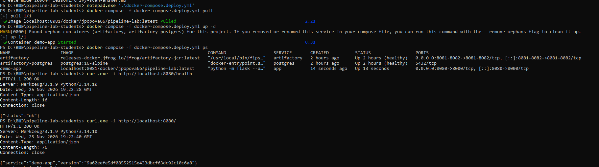

# Занятие 1. Шаг 7. Деплой приложения

Контейнер `demo-app` запущен через Docker Compose из образа `localhost:8081/docker/jpopova66/pipeline-lab:latest`. В выводе `docker compose -f docker-compose.deploy.yml ps` видно, что контейнер запущен и порт хоста `8080` перенаправляется на порт контейнера `8000`.

Оба запроса вернули `HTTP/1.1 200 OK`.

```text
GET /health
{"status":"ok"}

GET /
{"service":"demo-app","version":"9a62eefe5df08552515e433dbcf63dc92c10c6a8"}
```

Поле `version` указывает на [коммит сборки](https://github.com/Jpopova66/pipeline-lab/commit/9a62eefe5df08552515e433dbcf63dc92c10c6a8).


