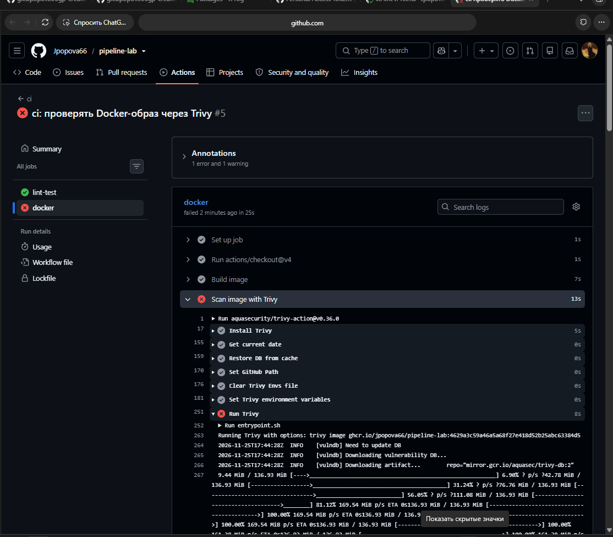
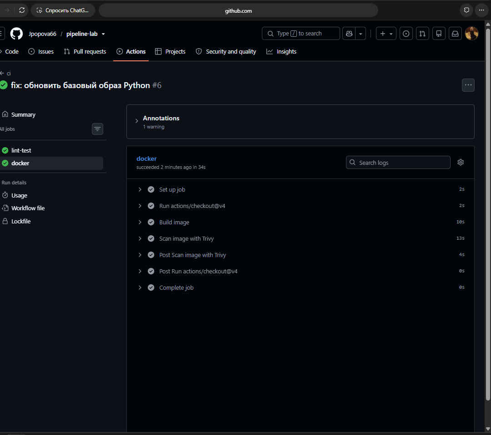

# Занятие 1. Шаг 4. Проверка Docker-образа через Trivy

- **CVE** — идентификатор публично зарегистрированной уязвимости. **Severity** — оценка её серьёзности.
- **CRITICAL** — уровень серьёзности выше **MEDIUM**. В этом workflow фильтр `severity: CRITICAL` ограничивает проверку для принятия решения о сборке критическими находками.
- **`exit-code: "1"`** заставляет Trivy завершиться с ненулевым кодом при таких находках. GitHub Actions отмечает шаг и задание как неуспешные. Если публикация зависит от успешного сканирования, образ с критическими находками до неё не дойдёт.

В [прогоне с `python:3.8-slim`](https://github.com/Jpopova66/pipeline-lab/actions/runs/45667829370/job/139394820381) Trivy нашёл 9 критических уязвимостей и завершился с кодом 1. После перехода на `python:3.14-slim` [сборка и проверка прошли](https://github.com/Jpopova66/pipeline-lab/actions/runs/45667860308/job/139395004337) с тем же порогом `CRITICAL`.

## Скриншоты прогонов

**До обновления.** Сборка прошла, шаг Trivy завершился ошибкой. По полному логу сканер обнаружил 9 критических уязвимостей и вернул код `1`.

**После обновления.** Образ на базе `python:3.14-slim` успешно собран и прошёл проверку Trivy с порогом `CRITICAL`.
